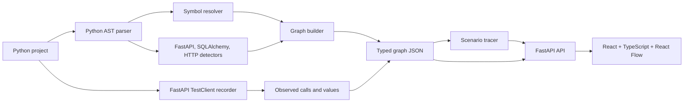

# CodeFlow

CodeFlow analyzes one Python backend request path at a time. Its static analyzer parses Python source with `ast`, resolves common calls, and detects FastAPI routes, SQLAlchemy reads/writes, and outbound HTTP calls. The local viewer traces a selected route and lets you inspect its source. Runtime recordings add observed calls and values to that graph.

The MVP targets Python 3.11+, FastAPI, and SQLAlchemy 2.x. Analysis and recording are deterministic and local; CodeFlow does not use an LLM.

## Quickstart

From the repository root in PowerShell, run these five commands:

```powershell
py -m venv .venv
```

```powershell
.venv\Scripts\Activate.ps1
```

```powershell
python -m pip install -e "analyzer[dev]" -e server
```

```powershell
Set-Location web; npm ci; npm run build; Set-Location ..
```

```powershell
codeflow serve "C:\path\to\your\python-backend"
```

Open <http://127.0.0.1:8000>, choose a route, then use the playback controls to inspect its scenario. Select **Open project** to switch to another local folder or enter a GitHub repository URL, such as `https://github.com/owner/repository`. Git must be installed for GitHub repositories; CodeFlow uses your configured Git authentication and reads the default branch without running repository setup scripts. The repository files are held in a temporary directory for the running server and removed when it exits.

The included `demo_app` is an analyzer fixture. Its SQLite schema starts empty and CodeFlow does not insert sample users or products.

To capture runtime evidence for a route in a project you selected, run `record` with a payload that matches that app before starting or restarting the viewer:

```powershell
codeflow record "C:\path\to\your\python-backend" --route "POST /orders/{order_id}/pay" --path-params '{"order_id":"42"}' --header "X-User-ID: 7" --payload "C:\path\to\payload.json"
```

`record` uses only the path parameters, headers, and JSON body you supply; it does not invent user IDs or request values. It invokes the selected application route, so it can perform that application's normal writes and outbound calls. It does not replace external services with mock responses. Runtime mode shows the captured calls; Both keeps static and observed edges visible together.

## Architecture



The implementation is split across `/analyzer`, `/server`, `/web`, `/demo_app`, and `/tests`. Parsers implement a small project-parser interface so another language parser can be added later without changing the graph consumer.

## Graph schema

The canonical Pydantic models live in `analyzer/src/codeflow/schema.py`; matching TypeScript interfaces are in `web/src/types.ts`.

- **Node:** `id`, `kind`, `name`, `qualname`, optional `file`, `line_start`, `line_end`, and `meta`. Kinds are `module`, `function`, `class`, `route`, `model`, `table`, and `external`.
- **Edge:** `id`, `source`, `target`, `type`, `kind`, and `meta`. Types are `calls`, `imports`, `reads`, `writes`, `depends_on`, and `http_call`. Confidence kinds are `parsed`, `observed`, and `inferred`.
- **Route:** `id`, `method`, `path`, and `handler_node_id`.
- **Graph:** `nodes`, `edges`, `routes`, and `meta` (including warnings and model-to-table mappings).
- **Stable source IDs:** `<relative_file>::<qualname>`. Synthetic routes, tables, unresolved calls, and runtime-only frames use descriptive stable IDs in the same graph namespace.

Static calls that cannot be resolved are represented by inferred edges to `unresolved:<name>` placeholders. If a runtime edge has no static counterpart, it is added as an observed ghost edge with a guessed `meta.mechanism`; a matching static edge keeps its original kind and gains `meta.observed`.

## CLI and API

```text
codeflow analyze <path> -o graph.json
codeflow trace <path> --route "POST /orders" [-o scenario.json] [--max-depth 8]
codeflow record <path> --route "POST /orders" [--path-params '{"id":"42"}'] [--header "Name: Value"] [--payload payload.json] [-o graph.observed.json]
codeflow serve <local-folder-or-github-url> [--host 127.0.0.1] [--port 8000]
```

The viewer's project picker accepts a local folder path or a GitHub HTTPS repository URL. Local paths are analyzed in place. GitHub repositories are cloned into a temporary local directory using Git's existing authentication configuration.

The server provides `GET /api/graph`, `GET /api/routes`, `GET /api/scenario?route=...`, and `GET /api/source?node_id=...`. The scenario endpoint accepts `mode=static`, `observed`, or `both`.

## Tests and checks

From the repository root:

```powershell
python -m pip install -e "demo_app[test]"
py -m pytest -q tests
py -m ruff check analyzer/src/codeflow server/src tests
py -m mypy analyzer/src/codeflow server/src/codeflow_server
Set-Location web; npm run build; Set-Location ..
```

Tests use isolated SQLite databases and replace external HTTP clients with mock transports. The application and `record` use the configured database and real HTTP client without seeded or fallback records.

## Known limitations / next steps

- Call resolution is best-effort. Aliases, reflection, runtime-generated routes, complex dependency providers, and indirect dispatch can remain inferred or unresolved.
- Route tracing is a cycle-safe breadth-first traversal; it is a useful scenario summary, not a full execution scheduler. Runtime order is available only for the one request that was recorded.
- Recording invokes FastAPI applications through `TestClient`; provide any required path parameters, headers, and body explicitly. The request uses the target application's configured database and real outbound HTTP clients.
- GitHub URLs open the repository's default branch. Git symlinks and subdirectory-only URLs are not included in the temporary source snapshot.
- Captured values are bounded summaries, not full object snapshots. Sensitive-looking keys are redacted, but custom object representations may contain application-specific data.
- The Python 3.12+ `sys.monitoring` recorder path is implemented but was not exercised in the Python 3.11 validation environment; the `sys.setprofile` fallback was exercised.
- The current parser and detectors support Python, FastAPI, and SQLAlchemy 2.x only.

Next steps from the MVP brief: a tree-sitter parser for other languages, field-level data lineage, OpenTelemetry ingestion, a git-history view, and optional LLM-grounded tour narration.
