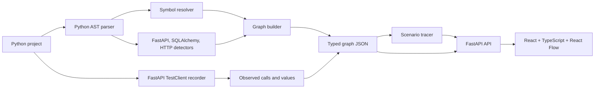

# CodeFlow

CodeFlow analyzes one Python backend request path at a time. Its static analyzer parses Python source with `ast`, resolves common calls, and detects FastAPI routes, SQLAlchemy reads/writes, and outbound HTTP calls. The local viewer traces a selected route and lets you inspect its source. Runtime recordings add observed calls and values to that graph.

The MVP targets Python 3.11+, FastAPI, and SQLAlchemy 2.x. Analysis and recording are deterministic and local; CodeFlow does not use an LLM.

## Quickstart

From the repository root in PowerShell, run these five commands:

```powershell
py -m venv .venv
```

```powershell
.venv\Scripts\Activate.ps1
```

```powershell
python -m pip install -e "analyzer[dev]" -e server -e "demo_app[test]"
```

```powershell
Set-Location web; npm ci; npm run build; Set-Location ..
```

```powershell
codeflow serve demo_app
```

Open <http://127.0.0.1:8000>, choose a route, then use the playback controls to inspect its scenario. The demo seeds a local SQLite database with a user and two products.

To record the `POST /orders` example before starting the server, create a JSON payload and record it:

```powershell
'{"items":[{"product_id":1,"quantity":1}]}' | Set-Content "$env:TEMP\codeflow-payload.json"
codeflow record demo_app --route "POST /orders" --payload "$env:TEMP\codeflow-payload.json"
```

Then run `codeflow serve demo_app`. The server loads `demo_app/graph.observed.json` at startup. `record` replaces that file by default; use `-o` to write elsewhere. Runtime mode exposes observed calls, while Both keeps static and observed edges visible together.

## Architecture



The implementation is split across `/analyzer`, `/server`, `/web`, `/demo_app`, and `/tests`. Parsers implement a small project-parser interface so another language parser can be added later without changing the graph consumer.

## Graph schema

The canonical Pydantic models live in `analyzer/src/codeflow/schema.py`; matching TypeScript interfaces are in `web/src/types.ts`.

- **Node:** `id`, `kind`, `name`, `qualname`, optional `file`, `line_start`, `line_end`, and `meta`. Kinds are `module`, `function`, `class`, `route`, `model`, `table`, and `external`.
- **Edge:** `id`, `source`, `target`, `type`, `kind`, and `meta`. Types are `calls`, `imports`, `reads`, `writes`, `depends_on`, and `http_call`. Confidence kinds are `parsed`, `observed`, and `inferred`.
- **Route:** `id`, `method`, `path`, and `handler_node_id`.
- **Graph:** `nodes`, `edges`, `routes`, and `meta` (including warnings and model-to-table mappings).
- **Stable source IDs:** `<relative_file>::<qualname>`. Synthetic routes, tables, unresolved calls, and runtime-only frames use descriptive stable IDs in the same graph namespace.

Static calls that cannot be resolved are represented by inferred edges to `unresolved:<name>` placeholders. If a runtime edge has no static counterpart, it is added as an observed ghost edge with a guessed `meta.mechanism`; a matching static edge keeps its original kind and gains `meta.observed`.

## CLI and API

```text
codeflow analyze <path> -o graph.json
codeflow trace <path> --route "POST /orders" [-o scenario.json] [--max-depth 8]
codeflow record <path> --route "POST /orders" [--payload payload.json] [-o graph.observed.json]
codeflow serve <path> [--host 127.0.0.1] [--port 8000]
```

The server provides `GET /api/graph`, `GET /api/routes`, `GET /api/scenario?route=...`, and `GET /api/source?node_id=...`. The scenario endpoint accepts `mode=static`, `observed`, or `both`.

## Tests and checks

From the repository root:

```powershell
py -m pytest -q tests
py -m ruff check analyzer/src/codeflow server/src tests
py -m mypy analyzer/src/codeflow server/src/codeflow_server
Set-Location web; npm run build; Set-Location ..
```

The demo uses SQLite and an HTTPX mock transport for its payment call in tests and during `record`.

## Known limitations / next steps

- Call resolution is best-effort. Aliases, reflection, runtime-generated routes, complex dependency providers, and indirect dispatch can remain inferred or unresolved.
- Route tracing is a cycle-safe breadth-first traversal; it is a useful scenario summary, not a full execution scheduler. Runtime order is available only for the one request that was recorded.
- Recording currently invokes FastAPI applications through `TestClient`, supplies `1` for path parameters, and infers the demo's required `X-User-ID` header from OpenAPI. Projects with other required headers, authentication flows, or request setup may need a future payload/header option.
- Captured values are bounded summaries, not full object snapshots. Sensitive-looking keys are redacted, but custom object representations may contain application-specific data.
- The Python 3.12+ `sys.monitoring` recorder path is implemented but was not exercised in the Python 3.11 validation environment; the `sys.setprofile` fallback was exercised.
- The current parser and detectors support Python, FastAPI, and SQLAlchemy 2.x only.

Next steps from the MVP brief: a tree-sitter parser for other languages, field-level data lineage, OpenTelemetry ingestion, a git-history view, and optional LLM-grounded tour narration.
